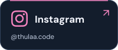

<h3></h3>

 

<h2></h2>

  
  

<h2></h2>

<h3></h3>

  
  
  
  
  
  

<h3></h3>

  
  
  
  
  
  

<h3></h3>

  
  
  

<h3></h3>

  
  
  
  
  

<h3></h3>

  
  
  

<h2></h2>

---

  <a href="https://github.com/Thulaa123?tab=repositories">Explore my repositories</a> &nbsp;·&nbsp;
  <a href="mailto:vinnath112@gmail.com">Say hello</a>

