

### Hey, I'm Thulana 👋

Full stack developer from **Sri Lanka**. Exploring ideas across **web, mobile, and cloud**.

 

## My toolkit

### Languages

  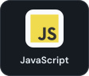
  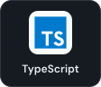
  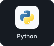
  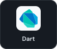
  
  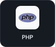

### Web & mobile

  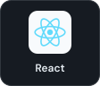
  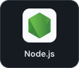
  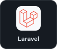
  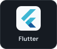
  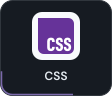
  

### Databases

  
  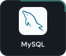
  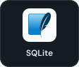

### Cloud & infrastructure

  
  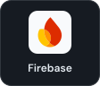
  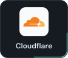
  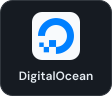
  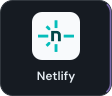

### Tools

  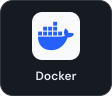
  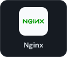
  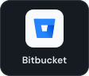

## Badges & community

## GitHub stats

  
  

---

  <a href="https://github.com/Thulaa123?tab=repositories">Explore my repositories</a> &nbsp;·&nbsp;
  <a href="mailto:vinnath112@gmail.com">Say hello</a>

